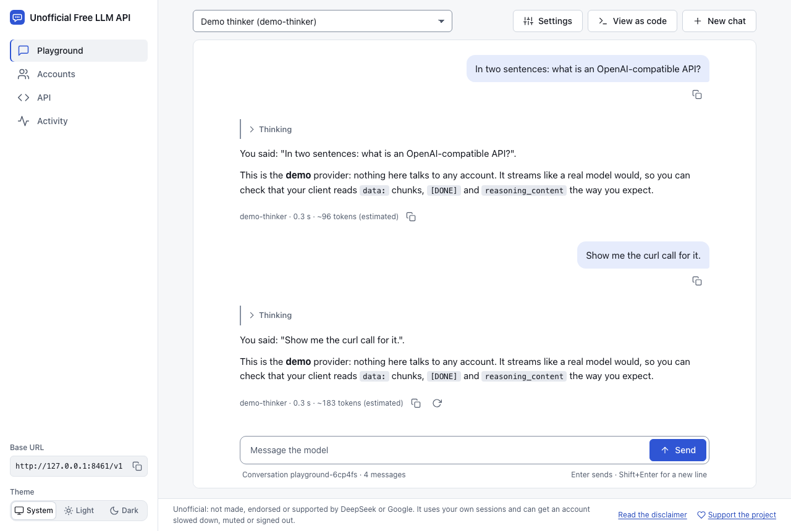
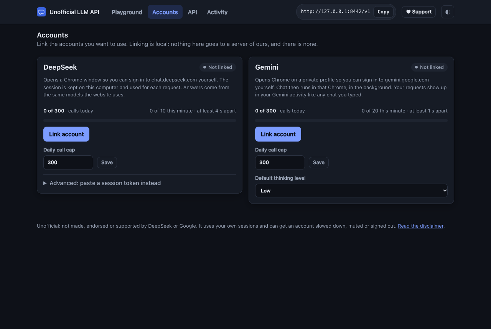

# Unofficial Free LLM API

[](LICENSE)
[](DONATE.md)
[](https://nodejs.org/)
[](#status-and-limits)

> **A local, OpenAI-compatible API and web playground for the personal accounts you already have.**
> Link your own DeepSeek chat account once, or paste a Qoder personal access token from your own account. Get a web interface to talk to it and `http://localhost:8420/v1`
> for your own code. No dependencies, no cloud, nothing leaves your computer except the requests to the provider.
> "Free" in the name means the free personal accounts and plan you already have: this adds no capacity, you get what your own account gets.

> **An experiment, for personal accounts.** DeepSeek works through its chat website, which you sign in to yourself. Qoder works through its **official CLI** (which this program drives), with a personal access token you make in your own account and the plan that account has; that is the only developer credential this program accepts. It does not use, ask for or support developer API keys from DeepSeek or Alibaba. The other API keys in it are the ones this program makes for your own local use. The DeepSeek website lane can be slow or break whenever the site changes, and it is not meant for production.

> **Unofficial, and it carries real risk.** This is not made or endorsed by DeepSeek or Qoder. The DeepSeek website lane may break DeepSeek's
> terms, and an account used that way can be slowed down, muted or signed out. Qoder is used through its official CLI, and every request counts against that account's plan.
> The program paces and caps itself to lower the risk, not to remove it. Read the [DISCLAIMER](DISCLAIMER.md) before you link anything, and use an account you can afford to lose.

## Quick start

You need Node.js 22 or newer. Google Chrome is needed to link DeepSeek. Qoder links with a pasted personal access token and needs no Chrome, but it needs its official CLI: `npm install -g @qoder-ai/qodercli`.

```bash
npx unofficial-free-llm-api@latest        # @latest: npx may otherwise run an older copy it kept; or: npx github:teminali/unofficial-free-llm-api, or git clone then npm start
```

The terminal prints a link and opens it: that is the web interface. It also prints your first API key (show it again any time: `unofficial-free-llm-api key show`, or the *Show* button on the API page).

1. **Accounts** → *Link account* → tick the box → sign in to DeepSeek in the Chrome window that opens → *I have signed in*. For Qoder, install its CLI (`npm install -g @qoder-ai/qodercli`) and paste a personal access token from [qoder.com/account/integrations](https://qoder.com/account/integrations). That opens no window.
2. **Playground** → pick a model and talk to it.
3. **API** → copy the base URL and a key into your own code.

No account yet? `npx unofficial-free-llm-api --demo --providers demo` starts with a demo provider that
answers by describing what it was sent, so you can try the interface and your client first.

## What you get

<p align="center">
  
  
</p>
<p align="center"><sub>The screenshots show the demo provider and local stand-ins, not a real account.</sub></p>

**A web interface** (served by the same process, no build step): a *Playground* with streaming, a thinking fold and
markdown; *Accounts* to link and unlink, with usage, limits and cooldowns; *API* for keys and copy-ready snippets;
*Activity* for the last requests (metadata only, never a prompt or an answer).

**API endpoints**: OpenAI-compatible, and the two other APIs most clients speak:

| Route | What |
|---|---|
| `GET /v1/models`, `GET /v1/models/{id}` | the models of the accounts that are linked right now, with a working `context_length`; DeepSeek's list is fixed and Qoder's follows the account |
| `POST /v1/chat/completions` | chat, streaming (`stream: true`), tool calls, JSON mode, `reasoning_content` |
| `POST /v1/responses` | OpenAI's Responses API: text, function calls, streaming, `previous_response_id` |
| `POST /v1/messages`, `POST /v1/messages/count_tokens` | Anthropic's Messages API: text, thinking, `tool_use`, streaming |
| `GET /health` | `{ "ok": true, "version": "…" }`, no key, for a container health check |

```python
from openai import OpenAI

client = OpenAI(base_url="http://localhost:8420/v1", api_key="sk-ula-...")
reply = client.chat.completions.create(
    model="deepseek-chat",
    messages=[{"role": "user", "content": "Say hello in five words."}],
)
print(reply.choices[0].message.content)
```

More in [docs/api.md](docs/api.md) and [examples/](examples/): curl, Python, Node, streaming, tool calling.

## Models

| Provider | Model ids | Notes |
|---|---|---|
| DeepSeek | `deepseek-chat` | the plain chat, answers in seconds |
| | `deepseek-reasoner` | DeepThink: thinks first and streams `reasoning_content`; its replies end after about two minutes |
| | `deepseek-auto` | the plain chat that can hand ONE hard question to DeepThink and build from the answer; matters when you send `tools` (agents) |
| Qoder | `qoder-<name>`, from the ids its CLI lists | one per model your Qoder account can call, read through the official CLI when you link and again when the list is 10 minutes old, or with *Read models again* on the Accounts page; the id is prefixed so a Qwen or Kimi model Qoder offers cannot be mistaken for another provider's. Thinking and effort use the CLI's own flags; tools are a text bridge, pictures go in as image blocks, and temperature is not a control the CLI has |
| Demo | `demo-echo`, `demo-thinker` | only with `--demo` |

Ids can also be written `deepseek/deepseek-chat` or `qoder/<id>`. `reasoning_effort` (`low`, `medium`, `high`) sets Qoder's reasoning effort: `low`/`medium`/`high`/`xhigh`/`max` become its `--reasoning-effort` flag, `none` becomes `--thinking disabled`, and `minimal` counts as low. DeepSeek ignores it and uses `deepseek-reasoner` for thinking. Every model lists a `context_length` of 128000: a working size this program chooses, not the model's maximum, because neither the DeepSeek website nor the Qoder CLI publishes limits. The API page has a box that copies the name, address, models and context size for a client with a form to fill in (the key is left for you to paste).

## How it works

A web chat takes one text message and answers with text. For every request the bridge:

1. **Checks the governor**: a cooldown, the daily cap or a full queue is answered at once with `429` and `Retry-After`, and nothing is sent upstream.
2. **Finds the chat.** An API request carries the whole conversation every time. If its first messages are exactly what an open chat already holds,
   the request is a continuation: it goes into that chat and carries only what is new. Anything else (an edited message, other tools, another model) starts a new chat.
   One conversation is one chat, like a person's. DeepSeek keeps that chat on its side; Qoder keeps one CLI process open, so a follow-up skips the startup instead of paying it again.
3. **Builds the message**: for a new DeepSeek chat, the system text, the transcript and, when you send `tools`, a short bridge that asks the model for a call in a plain
   format (a request with no tools is sent as it is); for a continued chat, just the new messages. A new Qoder chat gets the whole conversation as one prompt, with the same text
   tool bridge; a continuation sends only the new messages.
4. **Asks the account** (DeepSeek: its web endpoints with your saved session and its proof-of-work; Qoder: the official CLI,
   `qoder --print`, with your personal token in its environment), one request at a time, paced.
5. **Reads the answer** back into OpenAI shape: text, `reasoning_content`, `tool_calls`. A tool call is read from every shape these chats were seen
   to use, and only for tools you offered. A call cut off mid-way is asked for again once, then reported as an error.
   Qoder's CLI is asked for `stream-json` output with partial messages, so its answer and thinking stream as they come; its text tool calls are read like the
   website lane's, and its own output limit becomes `finish_reason: "length"`.

DeepSeek chats are removed when their conversation ends (20 minutes without a request, at most 6 open, or a chat grown long), and when the program stops. That covers the chats
this program created; other DeepSeek chats are never touched. Qoder's chat is a live CLI process, held in memory and never on disk: the CLI is told not to persist a session,
at most three chats are open, and each ends after ten idle minutes or twenty-four requests. A chat past 150,000 characters is replaced only when it holds clearly more than a new
chat would be told, so an agent's long task stays in one chat (DeepSeek and Qoder alike). A continued request reports what its chat already held as cached input tokens
(`usage.prompt_tokens_details.cached_tokens`; `cache_read_input_tokens` on the Anthropic API). A request that changes the model, the effort,
the tools or an earlier message starts a new process. Name a conversation with the `user` field or an `X-ULA-Session` header if you want it kept apart. `--no-sessions`
(or `ULA_SESSIONS=0`, or the switch on the Accounts page) goes back to one new chat for every request.

Linking DeepSeek never sees your password: you sign in yourself, in a Chrome window, and the bridge keeps the session that results. Qoder works differently: you paste a personal access token, which is never put on a command line or sent by this program over HTTP; it is handed only to the official Qoder CLI, in that process's environment, and the CLI makes the signed requests to Qoder.

## Safety built in

| What | How |
|---|---|
| Pace | DeepSeek: one request at a time, at least 4 s apart, at most 10 a minute (it waits, it does not fail). Qoder: 1 s apart, 20 a minute, and the provider's own rate limit is obeyed |
| One chat per conversation | A DeepSeek conversation stays in one provider chat instead of opening (and deleting) a chat for every message. A Qoder conversation keeps one CLI process open (at most three, in memory only, each closed after ten idle minutes), so a follow-up skips the CLI's startup. If continuing a chat fails twice in a row, it switches itself off and says so |
| Daily cap | 300 calls a day per account by default; change it on the Accounts page. This caps calls, not credits: Qoder counts each request against your plan |
| First refusal stops everything | A rate limit, a mute or a human check sets a cooldown (20 min for DeepSeek; Qoder pauses for at least a minute, since its CLI gives no `Retry-After`); a mute lasts as long as DeepSeek says. A token Qoder's CLI refuses is marked refused, and its model list is cleared |
| No retry storms | Retrying a muted account only makes it worse, so there is none; a cut-off call is retried once, an empty answer once, and a connection that failed before the message went out once (nothing was spent). A connection that breaks mid-answer is an error in words, never half an answer |
| Loop guard | An agent that repeats the same step three times in a row is stopped before another call is spent |
| Local only | Listens on `127.0.0.1`; other hosts are refused; a key is required for `/v1`; the web interface needs an admin token, which it trades for a session cookie (HttpOnly, SameSite=Strict, checked against the origin) |
| Secrets | Sessions and config are mode 0600 in a 0700 folder; config.json keeps each API key (so you can copy it again) next to the admin token that can make keys; a Qoder personal access token is kept in `qoder_key.json`, mode 0600, and handed only to the official Qoder CLI, in its environment, never on a command line; the CLI's own state is in a 0700 `qoder-cli/` folder; a kept Qoder chat is a live CLI process in memory, never a transcript on disk; only metadata is ever logged, with the token scrubbed |

Details in [docs/security.md](docs/security.md).

## Configuration

```
unofficial-free-llm-api [start] [--port 8420] [--host 127.0.0.1] [--data-dir DIR] [--no-open]
                           [--cors ORIGINS] [--no-key] [--no-sessions] [--demo] [--providers deepseek,qoder]
unofficial-free-llm-api key create [name] | key list | key show <id or name> | key revoke <id>
unofficial-free-llm-api status | login-url | doctor [--online] | selftest [--model id] [--turns 3] [--yes] | log [--lines 100]
```

Environment: `ULA_HOME` (data folder, default `~/.unofficial-free-llm-api`; a `~/.unofficial-llm-api` made by 0.1.x is kept in use while the new one does not exist), `ULA_PORT`, `ULA_HOST`, `ULA_SESSIONS=0` (no session reuse), `ULA_DEBUG=1` (log lines to stderr),
`ULA_DEEPSEEK_HIDDEN=1` (run DeepSeek's sign-in check hidden; DeepSeek blocks that), `ULA_CHROME_PATH`.

`doctor` checks the computer (Node, Chrome, the data folder's permissions, the port, the accounts) and says what to fix; `--online` also asks npm for the newest
version (the only time this program calls anything but your providers, and only when you ask). `selftest --yes` sends a short conversation through a running
server and tells you whether it stayed in one provider chat; it spends one request per turn and prints sizes and times, never words. Starting a second copy
prints the link of the one already running instead of an error.

Running on a server with no desktop? Qoder needs none: paste the personal access token on the Accounts page of the running copy. The Qoder machine needs the Qoder CLI installed (`npm install -g @qoder-ai/qodercli`). DeepSeek needs a desktop once, to link: see [docs/providers.md](docs/providers.md) for linking and for pasting a DeepSeek token by hand.

## Status and limits

Alpha. What has been run, honestly:

- The bridge, the server, the governor and the web interface have automated tests (`npm test`) that run against stand-ins: a scripted provider, a local copy of
  DeepSeek's endpoints (which can drop connections and break streams on request), and a script that behaves like the Qoder CLI (its model list, its one-shot and kept chats in JSON
  and stream-json, and each way it refuses).
- **Run by the author on their own real accounts:** on 2026-10-22, linking DeepSeek, chatting in the playground, a three-message DeepSeek conversation
  that stayed in one DeepSeek chat, and switching models (which starts another chat). DeepSeek answered in 3 to 8 seconds. On 2026-10-26, linking Qoder with a real
  personal access token and the official CLI: its 14 models were read, and chat completions came back through the local API with thinking on and off. A three-message
  Qoder conversation through the running relay stayed in one kept chat: the first answer took 17.1 s, the follow-ups 5.5 s and 4.7 s, the open CLI process took about
  490 MB, thinking disabled sent no reasoning while high effort sent reasoning, and ending the chat closed the process.
- **Not yet run against a real account:** an agent sending `tools`, long conversations, a day of steady use, `selftest --yes`, the Anthropic and
  Responses APIs with their own clients, and the no-desktop setup. Reusing one chat per conversation is built to fail safe (a chat that cannot be continued is given
  up and the request is asked again on a new chat; two such failures in a row switch it off), but only short real conversations have shown it work. An issue with what you
  saw (the lines from `unofficial-free-llm-api log`, no prompts) is the most useful contribution there is. A client's own test button may give up before the Qoder CLI answers the
  first call of a conversation; that call pays for the CLI starting up, so a longer client timeout helps, and later messages in the same conversation answer in a few seconds.
- Pictures: DeepSeek takes pictures sent inline (a `data:` URL in a user or tool message) as attached files, the newest four of a message, each up to 10 MB; a picture that cannot go is said to the model in the prompt. What DeepSeek's chat does with a picture (read its text, or look at it) is DeepSeek's, not this program's. Qoder takes them the same way (newest four, 10 MB each) as image blocks of the CLI's stream-json input, placed where the message put them; every model the CLI listed on 2026-10-27 read one. Pictures sent through the Anthropic and Responses APIs go too. A picture given as an address (never fetched) becomes a note.
- Files: a text file sent inline (a chat `file` part, a Responses `input_file`, an Anthropic `document`) is written into the prompt under its name, up to 200,000 characters. Any other file (a PDF, an archive, one named by id or address) is named in the prompt as left out, so the model says it cannot see it; Qoder's CLI drops PDF blocks without a word and only passes a file path that the model would need a tool to open.
- Not supported: `top_p`/`seed` and the like (named in an `X-ULA-Ignored` response header, not silently dropped; `temperature` is ignored by both providers), `max_tokens`/`stop` when tools are sent (honoured for a plain chat), `n > 1` (refused), embeddings, function-call strictness. Token counts are estimates (characters / 4).
- Providers change their sites without notice. When one breaks, [open an issue](../../issues).

## If something does not work

**DeepSeek shows a blank page that keeps redirecting, or "I have signed in" says you are not signed in.** Chrome may be refusing to let `chat.deepseek.com` save anything on your computer (Chrome calls it *On-device site data*; the address bar shows a crossed-out eye or "not allowed"). Without saved data a sign-in cannot stay, so the page loops between the app and the sign-in page. This is a Chrome setting, an extension or a Chrome privacy feature, not something DeepSeek or this program does (a fresh Chrome profile that visits DeepSeek keeps the default, which is allowed). To fix it:

1. Do **not** use the address-bar panel on the page that is redirecting: it closes every time the page reloads. Open a **new tab** instead.
2. Go to `chrome://settings/content/siteData` (Settings, Privacy and security, Site settings, On-device site data).
3. Choose *Sites can save data on your device*, or look under *Not allowed to save data* and remove `chat.deepseek.com`.
4. Check that no extension blocks cookies or site data for the site (try a private window with extensions off).
5. Reload `chat.deepseek.com`, sign in again, then press **I have signed in**.

This applies to the Chrome window this program opens as well: when its check cannot read a saved sign-in because storage is blocked, the Accounts card says so and names this setting. If you would rather not touch Chrome's settings, the Accounts page also takes a session token pasted by hand (*Advanced*).

**"I have signed in" opens the sign-in window again, or says DeepSeek refused the check.** The check opens an ordinary Chrome window for a few seconds. DeepSeek answers a hidden Chrome with a "request blocked" page, so the hidden mode is off unless you set `ULA_DEEPSEEK_HIDDEN=1`. If it still fails, run `unofficial-free-llm-api log` and look at the lines that start with `deepseek:` (no prompts, no keys are in them).

**Qoder says the token was refused, shows no models, or says the CLI is missing.** A personal access token the CLI refuses is marked refused and its model list is cleared; make a new token at [qoder.com/account/integrations](https://qoder.com/account/integrations) and paste it under *Replace token*. If the Qoder CLI is not installed, linking says so: install it with `npm install -g @qoder-ai/qodercli`, then link again. A 429 from the CLI pauses requests for a minute; the CLI gives no `Retry-After`. If linking fails because the model list could not be read, the message says so rather than guessing a model list; *Read models again* retries it. If the CLI answers but a client's connection test times out, raise that client's own timeout: the first CLI call takes longer while it starts, and a chat is not cut off by the client's test wall.

## Development

```bash
git clone https://github.com/teminali/unofficial-free-llm-api && cd unofficial-free-llm-api
npm install          # only for the UI tests (jsdom); the program has no dependencies
npm test
npm run demo         # the interface with the demo provider, no account needed
```

See [CONTRIBUTING.md](CONTRIBUTING.md).

## Support

If this saved you time, [a coffee's worth of crypto](DONATE.md) is a good way to say so. It stays free either way.

## License

MIT. See [LICENSE](LICENSE).
